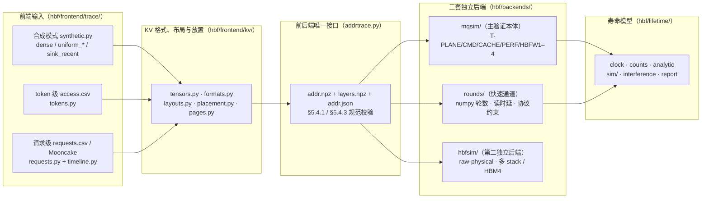

# MQSim-HBF：面向 LLM KV Cache 的 HBF 模拟与分析平台

本项目围绕 **OCP HBF 规范 v0.7.0** 研究将大语言模型推理的 KV cache 存放在 **HBF（High Bandwidth Flash）** 上的读带宽、写入干扰、压缩收益与闪存寿命。

架构采用统一的 **「前端 → 地址轨迹 → 多后端」** 分层设计，默认即 OCP HBF v0.7.0 规范行为（`ocp` 拓扑、HBF 命令模型、自动 prefill、多请求默认 `packed` 放置与 §5.4.1 / §5.4.3 地址合法性校验）：

- **前端（`hbf/frontend/`）**：接收合成访问模式、token 级 `access.csv` 或真实请求级轨迹（`requests.csv` / Mooncake），经 KV 存储格式、布局、多请求放置与时间线展开，生成前后端唯一的标准**地址轨迹**（`addr.npz` + `layers.npz` + `addr.json`）。
- **三套互补后端（`hbf/backends/`）**：
  - **MQSim-HBF**（单 stack 主验证本体，含 `T-PLANE`/`T-CMD`/`T-CACHE`/`T-PERF`/`T-HBFW1`–`T-HBFW4` 共 14 个补丁）；
  - **轮数与解析后端**（`rounds/`，numpy 快速通道，用于参数扫描、MOCS/主机协议约束与寿命时钟校准）；
  - **HBFSim**（第二独立后端，MIT 许可，原生支持多 stack、HBM4 与 D2D 链路，另附可选按 die 阻塞补丁）。
- **微内核与可选扩展（`hbf/ext/`）**：GPU roofline/TPOT（`ext/system/`）与第 3 阶段高级 KV 方法（`ext/kv_terms/`）均通过统一注册表按需加载；**删除整个 `hbf/ext/` 不影响核心模拟器运行**。

> **当前状态**：第 4 阶段整理与重构（R0–R9）已在 `refactor/modular` 完成，最近一次全量测试 **`579 passed, 3 xfailed`**（[测试日志](evidence/pytest/r7_r9.log)）。详细实测、源码依据、规范核查与三后端对比见 [REPORT.md](REPORT.md)；开发规划与任务分工见 [PLAN.md](PLAN.md)。

---

## 安装

### 运行环境
- **操作系统**：Linux
- **核心依赖**：Python 3.11+、`numpy>=1.24`
- **MQSim 后端**：`g++`（C++11）、`make`、`git`、GNU time（`/usr/bin/time`）。仓库内含固定版本 MQSim 源码与 SHA-256 校验清单，构建**无需联网**；首次运行在 `.build/` 自动校验、打补丁并编译（约 10–30 s）。
- **HBFSim 后端（可选）**：`g++`（C++20，如 GCC 13+）、`cmake`（3.20+）、`ninja`（可选，加速编译）。首次构建通过 `scripts/hbfsim_build.sh` 拉取锁定提交并编译到 `.build/hbfsim/`（约 30 s）。
- **开发与测试**：`pytest`（`requirements-dev.txt`）。

### 安装与构建命令

```bash
# 安装 hbf 包（安装后可用 `hbf` 代替 `python3 -m hbf`）
python3 -m pip install .

# 安装测试依赖
python3 -m pip install -r requirements-dev.txt

# （可选）拉取锁定提交并编译 HBFSim 第二后端（hbfsim 与 hbfsim_reference）
bash scripts/hbfsim_build.sh
```

---

## 快速开始

统一命令行入口为 `python3 -m hbf <子命令>`（`run`、`check`、`sweep`、`lifetime`、`system`、`interference`）；旧入口迁移对照见 [docs/cli-migration.md](docs/cli-migration.md)。**不加额外开关即为 OCP 规范默认行为**（`ocp` 拓扑、HBF 命令模型、单请求 MQSim 自动 prefill）。

最小 MQSim 运行（默认 `ocp` 拓扑与自动 prefill，自动产出 `addr.npz`、`layers.npz`、`addr.json` 与 `config.json`）：

```bash
python3 -m hbf run --layers 1 --heads 2 --context 512 --blocks-per-plane 32
```

轮数估算 + MQSim 同轨迹抽查核对（`check` 子命令，输出 `check.json` 对比估算与实测时延）：

```bash
python3 -m hbf check --layers 1 --heads 2 --context 512 --blocks-per-plane 32 --mode uniform_pages --fraction 0.25
```

仅运行轮数与机制分析后端（不编译、不运行 MQSim），同时比较独立 plane 与 16-plane 联动组：

```bash
python3 -m hbf run --analysis-only --layers 4 --context 8192 --mode uniform_pages --fraction 0.05 --plane-group 1 --plane-group 16
```

使用 `--set section.key=value` 覆盖结构化配置项（同样适用于 TOML/JSON 配置文件，如 `python3 -m hbf run CONFIG.toml --set kv.format=kivi2`）：

```bash
python3 -m hbf run --set backend.name=rounds --set kv.model=llama-3.1-8b --set kv.layout=striped_contiguous --set kv.context=8192 --set kv.format=kivi2 --set placement.batch=8 --set ext.system.gpu=b200
```

启用主机协议约束（UCIe 档位 2、每主机通道 MOCS = 256、`fcfs` 发射顺序）：

```bash
python3 -m hbf run --analysis-only --layers 4 --context 8192 --mode sink_recent --layout striped_contiguous --mocs 256 --host-order fcfs --ucie-grade 2
```

运行寿命解析模型（`lifetime` 子命令，支持 `--hours N` 事件模拟与 `--requests-csv` 真实请求流）：

```bash
python3 -m hbf lifetime --analytic --no-calibrate --model llama-3.1-8b --format bf16,kivi2 --workload long32k --rd-threshold 1e6
```

每次运行会在末尾打印输出目录路径（省略 `--output` 时写入 `runs/`），并保存解析后的完整 `config.json` 与 `meta.json`。全部子命令选项见 `python3 -m hbf <子命令> --help`。

运行测试套件：

```bash
# 快速回归（不含规模测试，约 2 分钟）
python3 -m pytest -q -m 'not scale'

# 完整测试（含规模测试与 MQSim，单进程约 7–8 分钟）
python3 -m pytest -q
```

> **内存提示**：1,024 plane（每 plane 512 块）的 MQSim 进程峰值内存约 **4.2 GB**，请务必**同一时间只运行一个** 1,024-plane MQSim 进程（不要用 `-n` 并行跑规模测试）。轮数分析（`--analysis-only`）与 HBFSim（约 0.4 GB）可安全并行。

---

## 架构与目录结构



```
.
├── README.md                  项目说明（本文件）
├── REPORT.md                  完整验证与实验报告（第 0–2 阶段、R1–R9 核对）
├── PLAN.md                    研究目标、阶段状态与协作规则
├── docs/
│   ├── traces.md              请求级 requests.csv、Mooncake 导入与 access.csv 格式规范
│   ├── cli-migration.md       旧命令行入口到统一子命令的对照表
│   ├── local-runs.md          本地批量实验运行清单
│   ├── design/                各阶段与重构设计文档（restructure.md 等）
│   └── research/              参数出处与文献依据（params.md）
├── hbf/
│   ├── __main__.py            统一入口 python3 -m hbf
│   ├── cli.py                 子命令分发（run / check / sweep / lifetime / system / interference）
│   ├── run.py                 TOML/JSON 配置解析、--set 覆盖、config.json 与 check 汇总
│   ├── registry.py            统一插件注册表（内置方法与 hbf.ext.* 共用）
│   ├── sweep.py               配置键笛卡儿积参数扫描
│   ├── models.py              核心模型形状预设
│   ├── device/                config.py（参数与拓扑预设）、address.py（§4.6 静态地址映射）
│   ├── frontend/              trace/（tokens/synthetic/requests）、kv/（tensors/formats/layouts/placement）、
│   │                          pages.py、refresh.py、timeline.py、addrtrace.py
│   ├── backends/
│   │   ├── mqsim/             build.py · schedule.py · run.py · parse.py
│   │   ├── rounds/            analysis.py · timing.py
│   │   └── hbfsim/            build.py · convert.py · run.py · parse.py
│   ├── lifetime/              geometry.py · clock.py · counts.py · analytic.py · interference.py ·
│   │                          report.py · cli.py · sim/
│   ├── ext/                   可选扩展（可整体删除）：system/、kv_terms/
│   ├── configs/               parameters.json、XML 模板、hbfsim-ocp.cfg、模型/负载预设
│   ├── patches/               MQSim 补丁（14 个，见 series）与 patches/hbfsim/（按 die 阻塞开关）
│   ├── mqsim/                 固定 commit 的 MQSim 上游源码（mqsim.commit / mqsim.sha256）
│   └── hbfsim.commit          锁定的 HBFSim 上游 commit（源码按需拉取至 .build/hbfsim/）
├── scripts/                   下载与实验复现脚本（download_mooncake.sh、hbfsim_build.sh、r5/r6/r7/r9）
├── tests/                     579 项测试（含 reference/ 纯 Python 对照、无扩展核心测试、HBFSim 与 R7 测试）
└── evidence/                  实测汇总 CSV、配置网格与全量 pytest 日志
```

---

## 配置文件与子命令

一次运行可由单个 **TOML 或 JSON** 配置文件描述，固定划分为 7 个节，并用可重复的 `--set section.key=value` 临时覆盖：

```toml
[device]
topology = "ocp"              # 默认合规 OCP 拓扑（32 core-ch x 2 die x 16 bank = 1,024 bank）
pages_per_block = 256         # 假设值，出处见 hbf/configs/parameters.json 与 docs/research/params.md

[trace]
mode = "uniform_tokens"
fraction = 0.05
seed = 1

[kv]
model = "llama-3.1-8b"
layout = "striped_contiguous"
context = 8192
format = "kivi2"

[placement]
batch = 8
alloc = "packed"              # 多请求默认 packed

[backend]
name = "rounds"               # "mqsim" 或 "rounds"

[ext.system]
gpu = "b200"
overlap = "serial"
```

| 子命令 | 用途 | 示例 |
|---|---|---|
| `hbf run` | 执行一次完整模拟或轮数分析 | `python3 -m hbf run run.toml --set kv.format=fp8` |
| `hbf check` | 同一份地址轨迹同时跑轮数估算与 MQSim 并输出 `check.json` | `python3 -m hbf check --layers 2 --context 4096` |
| `hbf sweep` | 按 JSON 网格做配置键笛卡儿积扫描并汇总 `summary.csv` | `python3 -m hbf sweep evidence/grids/item2-compression.json` |
| `hbf lifetime` | 解析稳态（`--analytic`）或事件模拟（`--hours N`）寿命评估 | `python3 -m hbf lifetime --hours 24 --workload long32k` |
| `hbf system` | 对已有运行目录重算不同 GPU / 重叠策略的 TPOT（`ext/system`） | `python3 -m hbf system RUN_DIR --overlap prefetch:1` |
| `hbf interference` | 对已有运行目录计算写入/刷新干扰解析近似 | `python3 -m hbf interference RUN_DIR --write-gb-s 2.5` |

每次运行都会写出解析后的 `config.json`（完整配置）和 `meta.json`（结果元数据、代码与后端 commit）。

---

## 地址轨迹格式（前后端唯一接口）

所有前端产出、所有后端（MQSim、轮数估算、HBFSim）消费的唯一接口定义在 [hbf/frontend/addrtrace.py](hbf/frontend/addrtrace.py)，落盘为三个文件：

1. **`addr.npz`（逐页操作记录，按 `(step, layer)` 流式组织）**：
   | 列 | 类型 | 说明 |
   |---|---|---|
   | `step`, `layer`, `subbatch` | `int64` | 归属步/层及提交子批号（`step = -1` 表示 prefill/初始化写）；到达时刻由各后端按 `(step, layer, subbatch)` 统一赋值 |
   | `request` | `int64` | 多请求放置时的请求编号 |
   | `op` | `U1` | `R`（读）、`W`（写）、`D`（逻辑释放，不发器件命令，只更新页存活状态；擦除不单列，写块第 0 页按 §5.4.1 自动触发） |
   | `lpa` | `int64` | 主机逻辑页地址；物理位置 `(channel, die, plane, block, page)` 由 [hbf/device/address.py](hbf/device/address.py)（§4.6）唯一决定 |
   | `useful_bytes`, `burst_bytes`, `burst_runs` | `int64` | 有效字节、64 B 读突发字节与连续段数 |
   | `cls` | `U8` | 操作来源归因：`kv`、`prefill`、`flush`、`refresh`、`relocate` |
   同一 `(step, layer)` 内写排在读之前。
2. **`layers.npz`（逐 `step × layer` 旁表，含零 HBF 页的层）**：记录 `hbm_bytes`、`attended_tokens`、`attended_elements`、`hbf_elements`、`dequant_ops`、`tensor_tokens`（HBM 驻留张量与缓存命中不生成 HBF 页，只记录在此）。
3. **`addr.json`（元数据）**：器件配置 SHA-256 摘要、布局与生成参数、协议选项（MOCS、突发、发射序、UCIe 档位、联动感测），以及 **`resident`**（运行开始前已驻留在 HBF 中的 LPA 区间；带 prefill/写入的轨迹为空）。

默认开启 `addrtrace.validate()`，严格校验：① LPA 不越界；② 禁止读未写或已释放页（OCP §5.4.3 / 表 12 错误 `0x7`）；③ 块内严格顺序写，重写某块第 0 页前该块所有已写页必须已 `D` 释放（OCP §5.4.1）。

---

## 后端说明与差异对比

三个后端共享同一份地址轨迹，按研究目标明确分工：

- **MQSim-HBF（`hbf/backends/mqsim/`）**：**单 stack 写路径、刷新与寿命核对的主验证本体**。包含 14 个可开关补丁（`hbf/patches/series`）：仪表与修复（`I1`–`I4`）、性能修复（`T-PERF`，消除完成队列 O(n²) 查找，墙钟提速约 3 倍且结果逐位不变）、时序对照（`T-SUSP`、`T-ONFI`）、HBF 读模型（`T-PLANE`、`T-CMD`、`T-CACHE`）以及 R5 HBF 写入补丁（`T-HBFW1` 静态写与原地重写、`T-HBFW2` 页 0 自动擦除与 `HBF_WRITE_ORDER=read_first|fifo`、`T-HBFW3` 关 GC、`T-HBFW4` 每块 `(R, W, E)` 计数导出）。
- **轮数与解析后端（`hbf/backends/rounds/`）**：**快速通道**。纯 numpy 向量化实现，直接计算每层读轮数、读时间下界/估算、主机协议约束（MOCS、`fcfs`/`trigger` 发射顺序、64 B 读突发、UCIe 档位，已与 HBF-EventLab 核对）及寿命时钟标定；大范围扫描与天/年尺度寿命外推由它驱动，凡进入报告的关键结论均配 MQSim 抽查。
- **HBFSim（`hbf/backends/hbfsim/`）**：**独立交叉验证后端 + 后续多 stack / HBM4 / D2D 实验主后端**。锁定上游 MIT 仓库 [FlashLabAE/HBFSim](https://github.com/FlashLabAE/HBFSim) 提交 `8ab183cc`（不把源码纳入本仓，由 `scripts/hbfsim_build.sh` 拉取至 `.build/hbfsim/` 编译），使用 `raw-physical` 模式与 [hbf/configs/hbfsim-ocp.cfg](hbf/configs/hbfsim-ocp.cfg) 运行同一份地址轨迹，并通过 [0001-die-blocking.patch](hbf/patches/hbfsim/0001-die-blocking.patch) 提供可选开关 `hbf-die-blocking=false|true`（默认 `false` 保持上游按 plane 阻塞，开启后按 die 阻塞对齐 MQSim）。

| 维度 | MQSim-HBF | 轮数后端（`rounds/`） | HBFSim（`8ab183c` + 补丁） |
|---|---|---|---|
| **推荐定位** | 单 stack 写/刷新/寿命主验证本体 | 大范围扫描、MOCS/协议约束、寿命标定 | 独立交叉验证；多 stack + HBM4 + D2D 实验 |
| **速度与内存（1 GiB 读）** | ~5–15 s、~4.2 GB（单进程） | ~0.7 s、轻量（可并行） | ~1.0 s、~0.4 GB（可并行） |
| **读时序对照** | 1.321 ms（含 ONFI 290+20 ns 逐轮命令与总线争用） | 1.259 ms（估算），1.049 ms（轮数下界） | 1.058 ms（不拆批）/ 1.198 ms（8K 子批）；15 点为 MQSim 的 **0.90–0.97×** |
| **写规则与阻塞** | `T-HBFW1`–`T-HBFW4`，支持 `read_first` 与 `fifo`；按 die 阻塞 | 搭配 `interference.py`（`gaps`/`fifo`）近似 | 原生 `raw-physical`（`0x6`/`0x7`/页 0 擦除/无 GC），仅 FIFO；`hbf-die-blocking` 切换 plane/die |
| **读干扰/每块计数** | `T-HBFW4` 导出每块 `(R, W, E)` 计数（与前端 100% 逐块一致） | 前端按块统计 `max_block_reads` | 无器件内每块读计数（`raw-physical` 下由前端直接统计）；无读干扰/刷新 |
| **多 stack / HBM4 / 热模型** | 不支持 | 仅按比例分摊单 stack | 原生支持（含 base-die D2D 与 OCP §9.2 热模型）；严格校验每 stack $\le 16$ die（OCP 表 2/4） |

---

## 扩展（Extensions）

项目采用**微内核 + 统一插件注册表**（[hbf/registry.py](hbf/registry.py)）：核心内置方法（`bf16`/`fp8`/`int4`/`int2`/`kivi4`/`kivi2`/`think`/`quest`、4 种基础布局、通用合成模式、`ReadTimeClock`）与 `hbf/ext/` 下的扩展经**同一套接口**注册，核心代码从不静态导入 `hbf.ext`。

**删除整个 `hbf/ext/` 目录（或设置 `HBF_NO_EXT=1`）不影响核心模拟器运行**：MQSim 模拟、轮数分析与核心 `ReadTimeClock` 寿命外推均照常工作（由 [tests/test_core_without_ext.py](tests/test_core_without_ext.py) 强制守卫）。引用未装载扩展的功能时会明确报错并指明所属扩展包。

| 扩展 | 作用 | 主要配置节 / 选项 |
|---|---|---|
| [`hbf/ext/system/`](hbf/ext/system) | GPU roofline、decode TPOT 评估、MoE 线性层时间、TPOT 寿命时钟（`Clock`）、GPU `prefill_tok_s` 与 `gpus.json` | `[ext.system]`：`gpu`、`overlap`、`kv_consume`、`selection`；子命令 `hbf system` |
| [`hbf/ext/kv_terms/`](hbf/ext/kv_terms) | MLA / `mla_fp8` / DSA 索引器、Loki / SparQ 格式、`kvspec` 层与头分组（`hybrid`/`ssm`/`cla`/`yoco`/`duo`/`pyramid`）、K4 `KVGeometry`、K5 选择真实性（`density`/`select_static`/`reuse`/`query_groups`/`full_tensors`）、K6 `channel_select`、K7 分组放置 / 按类别分写前沿 / 前缀别名 | `[ext.kv_terms]`：`kv_spec`、`select_static`、`reuse`、`query_groups`、`full_tensors`、`frontiers`、`prefix_tokens`、`prefix_groups`、`prefix_reads`；格式 `mla`/`mla_fp8`/`loki`/`sparq`；模式 `channel_select` |

---

## 请求数据集与外部轨迹输入（R7）

除内置合成负载预设（`chat`、`long32k`、`agentic`、`reasoning`）与合成选页模式外，前端同时支持两类外部真实轨迹（完整字段定义与许可说明见 [docs/traces.md](docs/traces.md)）：

### 1. 请求级公共数据集（Mooncake FAST'25）
数据集文件不入仓，使用随仓库提供的幂等下载与 SHA-256 校验脚本拉取到 `.build/traces/mooncake/`：

```bash
# 下载 kvcache-ai/Mooncake FAST'25 conversation_trace.jsonl（Apache-2.0，12,031 条请求，约 1.4 MB）
bash scripts/download_mooncake.sh
```

- **统一 CSV 格式**（`hbf/frontend/trace/requests.py`）：`arrival_s,prompt_tokens,output_tokens[,prefix_id]`（可选 `prefix_tokens` 列），支持直接导入 Mooncake JSONL（按 512-token `hash_ids` 自动抽取共享前缀组）或任意统一 CSV。
- **直接驱动寿命模拟，并可与合成稀疏选页自由组合**：

```bash
# 真实 Mooncake 请求流（4 stack、300 s 前缀缓存）+ 合成 10% uniform_tokens 稀疏选页
python3 -m hbf lifetime \
  --requests-csv .build/traces/mooncake/conversation_trace.jsonl \
  --requests-retain-s 300 --stacks 4 --hours 24 \
  --mode uniform_tokens --fraction 0.1 --rd-threshold 1e5
```

- 端到端评估复现脚本：[scripts/r7_mooncake_eval.py](scripts/r7_mooncake_eval.py)（输出 [evidence/r7-mooncake-eval.csv](evidence/r7-mooncake-eval.csv)）。

### 2. Token 级外部轨迹（`access.csv`）
沿用 `step,layer,kv_head,kind,op,token_start,token_end,bits` 表头（[hbf/frontend/trace/tokens.py](hbf/frontend/trace/tokens.py)），通过 `python3 -m hbf run --access-csv PATH` 导入。基于 HF transformers 的 GPU 实时截取脚本预留位置为 `hbf/frontend/trace/capture/`，待 GPU 环境就绪后接入。

---

## 建模假设与局限摘要

- **规范未规定的器件参数均标为假设**：OCP HBF v0.7.0 将 `tR`、`tPROG`、`tBERS`、每块页数、P/E 上限、读干扰阈值 `X` 留给具体产品实现。默认 `parameters.json` 采用 SPLASH/文献假设（`tR = 4,096 ns`、`tPROG = 100 µs`、`tBERS = 1 ms`、`256` 页/块、`1,024 GB/s` 核心总带宽）并在 `assumptions` 字段注明出处，详细来源见 [docs/research/params.md](docs/research/params.md)；寿命结论始终以参数扫描范围给出。
- **单 stack 与多 stack 边界**：`ocp-8ch`（8 主机通道、512 bank）暂未接入寿命模型的固定 1,024-bank 设备几何；多 stack 交织、HBM4 分层与热模型已定位由 HBFSim 后端承接。
- **历史基线复现**：本分支默认即为 OCP 规范行为；若需逐位复现重构前（第 0–2 阶段旧默认）的报告数字，请检出 tag `baseline-pre-refactor`。

---

## 致谢与许可

- **MQSim**：CMU SAFARI [MQSim](https://github.com/CMU-SAFARI/MQSim)，许可见 [hbf/mqsim/LICENSE](hbf/mqsim/LICENSE)。
- **HBFSim**：[FlashLabAE/HBFSim](https://github.com/FlashLabAE/HBFSim)，MIT 许可（按需拉取至 `.build/hbfsim/`，不在本仓库内分发源码）。
- **Mooncake 轨迹**：[kvcache-ai/Mooncake](https://github.com/kvcache-ai/Mooncake) FAST'25 公开轨迹，Apache License 2.0（按需下载至 `.build/traces/mooncake/`，不入仓）。
