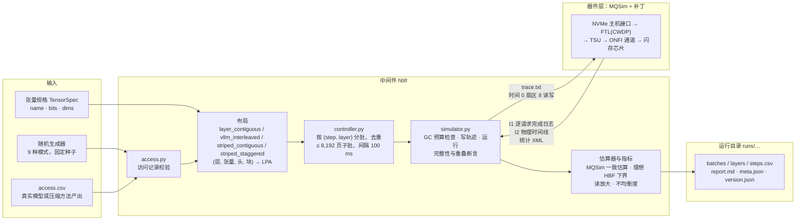
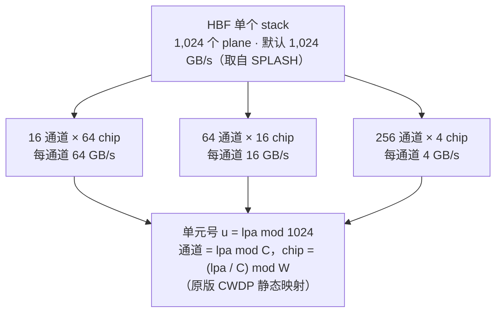

# MQSim-HBF：面向 KV cache 的 HBF 页级模拟链路

本项目研究：KV cache 存进 **HBF（High Bandwidth Flash）** 后，每生成一个 token 要读多少页，这些页能否整页、均匀地铺满各个 plane，又会出现哪些读放大、plane 冲突和排队。HBF 是放在 GPU 旁边、接口类似 HBM 的 NAND 闪存堆栈。项目做法是"现成的 NAND 器件模拟器 + 自己写的上层"：

- **器件层**：固定版本的 [MQSim](https://github.com/CMU-SAFARI/MQSim)（FAST 2018），使用它的事务调度、ONFI 通道和闪存芯片时序。对 MQSim 的修改全部以可开关的补丁形式保存。
- **中间件**：本仓库的 Python 包 `hbf`。它把"每步、每层、每个 KV 头读写哪些 token"翻译成 4 KiB 页请求和 MQSim 轨迹，跑完后还原出子批、层和 decode 步的时延与负载指标，并与两个解析估算器对照（多 plane 配置只用其中的理想下界，见下文"估算器 1 有适用范围"）。

> **当前状态：第 0 阶段已完成，第 1 阶段的模拟器改进已在开发分支上。** 第 1 阶段新增：容量扩到每 plane 512 块、不跑 MQSim 的机制分析模式、真实 die/plane 层级（T-PLANE）、HBF 命令模型（T-CMD）、cache read（T-CACHE）、SPLASH 式条带布局、规范示例拓扑 `ocp`、规范带宽档位，以及机制分析中的主机协议约束（命令额度、64 B 读、读突发、主机链路）。对照 OCP HBF 规范 v0.7.0 做了一致性修正（见 REPORT"规范一致性审查"）。最近一次全量运行 156 项通过、3 项 xfail，xfail 是如实记录的已知偏差，见[验证状态](#验证状态)。详细实测、源码依据和偏差分析见 [REPORT.md](REPORT.md)。

---

## 架构

### 数据流



### HBF 到 MQSim 的映射

MQSim 的 TSU 只在整颗 chip 空闲时才下发命令，同一 chip 上不同 die 的读实际是串行的（报告中 T0 实测确认）。所以**每颗 MQSim chip 只放 1 个 die、1 个 plane，代表 HBF 的一个 plane**。1,024 个并行单元按"通道数 × 每通道 chip 数"组织，这个拓扑是扫描变量：



一次页读在 MQSim 中依次经过：发命令（约 290 ns）→ 感测 tR（4,096 ns）→ R/B 就绪（20 ns）→ 通道传输（4096 B ÷ 每通道带宽）→ 主机接口（约 1 ns）。同一 chip 上感测和传输不能重叠，同一通道上的命令和数据传输共享总线。

### 规范示例拓扑（`--topology ocp`）

按 OCP HBF 规范图 4 的例子：16 个主机通道，每个主机通道接 2 条 core die 通道，每条通道挂 2 个 die，每个 die 16 个 bank，共 1,024 个 bank。在 MQSim 中是 32 个通道 × 每通道 2 个 chip（die）× 每 die 16 个 plane（bank），plane 独立寻址。地址按规范排列（`address_map: "ocp"`）：主机地址以 4 KiB 为单位在 16 个主机通道间交织；在一个主机通道内，4 KiB 单元的低 4 位选 bank，接下来 2 位选 die，die 0、2 在第一条 core die 通道，die 1、3 在第二条；第 64 个单元回到 die 0、bank 0 的下一页。中间件把这个顺序换算成 MQSim 能直接执行的地址，物理位置与规范逐页一致（有测试核对）。

规范的表 3 另写了"每 cube 16 个 die、每通道 16 个 bank"，信息不全（算不出 512 GiB），与图 4 的组织不能直接对应，这里按图 4 建模。规范没有规定 core die 通道的带宽，默认把 1,024 GB/s 平均分给 32 条通道。1,024 GB/s 取自 SPLASH，不是规范的三档之一（384、1,536、3,072），需要时用 `--aggregate-gb-s` 指定。

`ocp` 是多 plane 配置，跑 MQSim 时必须加 `--prefill`。在默认的 ONFI 命令时序下，一条 16 plane 的读命令约 10 µs（约 2.45 个 tR），而且按 die 门控（见"按 bank 调度"）。所以建议像 REPORT 的对照实验那样加 `--read-plane-ns 0 --coalesce-ns 1 --cache-read`。合并窗口取 1 ns 就够了：一个子批同时到达，任何大于 0 的窗口都能把它合成完整的多 plane 命令；更大的窗口只会给每层多加等待时间。

### 真实层级模式（T-PLANE）

上面的 chip 当 plane 是默认模式。打开 T-PLANE 补丁后，可以改用 die/plane 两级的层级：**通道 = 一个 die 到 base die 的数据通路，chip = HBF die，MQSim plane = HBF plane（规范称 bank）**，例如 `--topology 16x1 --planes 64`，即 SPLASH 假设的 16 die × 64 plane。每 die 64 个 plane 和"一个 die 独占一条通道"来自 SPLASH，不是规范；规范示例见上面的 `ocp` 拓扑（每 die 16 个 bank，两个 die 共用一条 core die 通道）。一个 die 的多个 plane 用一条 multi-plane 命令同时感测，plane 之间的地址规则可选：

| `--plane-rule` | 一条命令能合并哪些页 | 对应 |
|---|---|---|
| 不设（原版） | 页号相同，块号任意 | MQSim 上游规则 |
| `independent` | 每个 plane 任意块、任意页 | OCP HBF 规范（每个 bank 独立感测）、SPLASH |
| `lockstep` | 块号和页号都相同 | FlashAccel 的 megaplane |

一条 n plane 的读命令占总线 t_CS + n·6·t_WC + (n−1)·t_DBSY + t_WB + t_RR，t_DBSY 可用 `--dbsy-ns` 调整（原版 500 ns）。数据仍按页依次传出；不开 T-CACHE 时，传完之前 die 不接新命令。

ONFI 的逐 plane 地址周期按 SSD 设计，64 个 plane 时一条命令要 41 µs，是 tR 的 10 倍，会把轮数差异淹没。T-CMD 补丁提供两个 HBF 命令模型的选项：

- `--read-plane-ns δ`：n plane 读命令改为单 plane 命令加 (n−1)·δ，对应 base die 并行或广播地址；
- `--coalesce-ns W`：新到的事务先等 W 再下发，同一批中到达同一 die 的页合成一条命令，去掉"第一页到达空闲 die 时单独下发"的现象。此时每层每 die 的读命令数正好等于机制分析的轮数。

`--cache-read`（T-CACHE 补丁）实现双缓冲读：感测完成后数据移入 cache，die 立即可以开始下一轮感测，同时传出上一轮的数据；每个 die 最多允许一批数据在等待传出时再发新命令（缓冲按 die 记账，而规范按 bank 描述）；只有这类"cache 就绪"的读命令会排到已排队的数据传输之前，写和擦除仍按上游顺序。依据是 OCP 规范 §5.3.1 第 7 条："HBF supports two cache buffers for each bank to hold up to at least two pages of data"（支持每个 bank 两个缓冲，可存至少两页）。

### 模块一览

| 模块 | 作用 |
|---|---|
| [`hbf/access.py`](hbf/access.py) | 访问记录格式与校验、张量规格 `TensorSpec`、三种布局、9 种生成模式（含 StreamingLLM 式 `sink_recent`、Quest 式按 token 块选择的 `uniform_tokens`）、整体 prefill |
| [`hbf/controller.py`](hbf/controller.py) | token 区间到页的转换、批内去重、有用字节按区间并集计算、64 B 突发传输字节、子批划分、两个估算器和负载指标 |
| [`hbf/analysis.py`](hbf/analysis.py) | 机制分析：不跑 MQSim，按层计算读轮数、最少轮数、plane 利用率、均衡损失和感测放大，支持独立 plane 与同偏移联动两种组织；纯 Python 参考实现与 numpy 引擎结果逐行相同 |
| [`hbf/pages.py`](hbf/pages.py) | numpy 引擎的页集合：把访问记录直接变成每层去重后的页数组（有用字节、64 B 突发、连续段数）及其位置，HBM 层字节、被注意 token 数、反量化运算量 |
| [`hbf/timing.py`](hbf/timing.py) | 读时间估计（`--timing`）：理想下界，以及按核心通道逐轮累加、与 MQSim 校准过的估算；每块读次数 |
| [`hbf/formats.py`](hbf/formats.py) | 命名的 KV 存储格式（`--format`）：bf16、fp8、int4/int2、kivi4/kivi2、think、quest |
| [`hbf/model.py`](hbf/model.py)、[`hbf/system.py`](hbf/system.py) | 模型与 GPU 预设；系统级评估：线性层与注意力计算、HBF 读与计算的重叠、TPOT、KV 全放 HBM 的基线、HBM 容量 |
| [`hbf/simulator.py`](hbf/simulator.py) | 校验源码散列、打补丁、编译 MQSim；GC 预算检查；写轨迹；运行并对回逐请求完成日志；聚合结果 |
| [`hbf/config.py`](hbf/config.py) | 参数文件、三套 chip 当 plane 拓扑与 `ocp` 规范示例拓扑、设备与 workload XML 的生成和互相校验、CWDP 与 OCP 地址映射、主机通道、逻辑容量上界 |
| [`hbf/cli.py`](hbf/cli.py) | 一键入口：生成或导入 → 轨迹 → MQSim → 解析 → 简报 |
| [`hbf/mqsim/`](hbf/mqsim) | MQSim 上游原版源码，逐文件 SHA-256 校验，不直接修改 |
| [`hbf/patches/`](hbf/patches) | I1–I4 仪表与修复补丁，T-SUSP、T-ONFI 时序对照补丁，T-PLANE 多 plane 补丁，T-CMD HBF 命令模型，T-CACHE cache read；`series` 规定应用顺序 |
| [`hbf/configs/`](hbf/configs) | 参数 JSON、设备模板、三种拓扑的设备和 workload XML、模型与 GPU 预设（每项注明来源） |
| [`tests/`](tests) | T0–T10 验证测试、机制分析与 T-PLANE 测试、上游行为探针、规模测试 |
| [`evidence/`](evidence) | 随仓库保存的实测摘要和测试日志 |

---

## 能力范围

### 已支持

| 能力 | 说明 |
|---|---|
| 页级读时序 | 逐请求的到达、入队、完成时间；可选物理时间线，精确到每条命令的通道、chip、块、页 |
| 拓扑扫描 | 16×64、64×16、256×4 三种"chip 当 plane"配置，`ocp` 规范示例拓扑（见上），或任意"通道数x每通道 chip 数"（例如 16x16 即 256 个 plane，可作为对规范表 3 的另一种读法） |
| 真实 die/plane 层级 | T-PLANE：每 die 最多 64 个 plane，multi-plane 读写，独立或同偏移两种地址规则；`--prefill` 按地址顺序写满整个布局区间（含条带布局的填充页），使 MQSim 的物理位置与规范的静态映射一致。多 plane 配置下读未写过的页会被拒绝（规范对它返回错误 0x7） |
| 机制分析 | 页位置默认按 OCP 规范的静态映射（地址决定 bank 和页，`--placement static`），也可按 MQSim 的分配顺序（`--placement mqsim`）；`--analysis-only` 不跑 MQSim，默认用 numpy 引擎（32 层 × 128K 全量读约 0.7 s，纯 Python 参考实现约 40 s，两者结果逐行相同，`--engine` 可选），算出每层的读轮数、最少轮数 ⌈N/P⌉、plane 利用率 N/(R·P)、均衡损失和感测放大；`--plane-group` 可同时比较多种组织 |
| 协议约束 | 分析模式可选：每主机通道的命令额度（`--mocs`，规范 MOCS 寄存器取值 1 或 256–16,384）、是否支持读突发（`--read-burst`）、读整页还是只读需要的 64 B 段（`--read-unit`）、主机发送顺序（`--host-order fcfs` 一页命令一起排队，`trigger` 先发一条触发感测）、联动组的感测假设（`--group-sense arrived|whole`，默认 arrived 只感测命令已到的页；whole 在第一条命令到达时感测整组，规范和 HBF-EventLab 都没有规定）、主机链路档位（`--ucie-grade`，48/94/188 GB/s）。给出任一协议参数就启用协议约束；不给 `--mocs` 时不限额度。不支持读突发时每页要 64 条 64 B 读命令（规范 §5.3.1）；fcfs 主机下额度会限制同时在读的页数，trigger 主机下基本不会。机制取自 HBF-EventLab，并用它的实测结果核对 |
| 容量 | 默认每 plane 512 块，物理容量 512 GiB，与规范表 3 的数字相同；但表 3 是"用户容量"，MQSim 按 SSD 习惯预留 7%（OP），用户可见的逻辑容量为 476 GiB。HBF 没有 GC，规范中主机看不到预留空间。1,024 plane 时 MQSim 峰值内存约 4.2 GB |
| 布局对照 | `layer_contiguous`（同层的页轮转铺满全部单元）；`vllm_interleaved`（同层只落在 32 个单元上，作为布局与映射公式冲突的对照）；`striped_contiguous`（SPLASH 式条带：每层从相位 0 开始，各 (张量, 头) 区域之间留 P/(T·H) 页的间隔；区域长度是 P 的倍数时（如 32K BF16），头之间错开 P/(2H)，V 与 K 相隔 P/2，消除各头同一块落在同一 plane 的冲突）；`striped_staggered`（同上，间隔取奇数，相邻区域还落在不同的主机通道上，在 fcfs 额度限制下更均衡） |
| 压缩后的存储格式 | 用 `TensorSpec` 声明，或用 `--format` 选预设（bf16、fp8、int4/int2、kivi4/kivi2、think、quest，见 [`hbf/formats.py`](hbf/formats.py)）。张量可以只存一段 token（`window`，如 KIVI 量化部分 `[0, -R]`）、放在 HBM（`tier: hbm`，如 KIVI 的全精度残差窗口）、或作为每步整体读取的选择元数据（`role: meta`，如 Quest 页摘要，按每 token 一行均摊）。每页 token 数和有用字节按各张量计算 |
| 读时间估计 | `--timing`：每层的理想下界（有效轮数 × tR、最忙核心通道传输、最忙主机链路取大）和估算（按核心通道逐轮累加命令、感测、R/B、传输及 cache read 重叠）。估算在 HBF 命令模型下与第 8 轮保存的 MQSim 运行逐层对照，误差不超过 4.7%（[evidence/time-calibration.csv](evidence/time-calibration.csv)）。另给出时间分解、瓶颈和每块读次数 |
| 系统级评估 | `--model`、`--gpu`：线性层和注意力按 roofline 计时，HBF 读与计算可串行、预取或理想重叠，得到 TPOT、tokens/s，并与 KV 全放 HBM 对比、检查 HBM 容量；`--batch`、`--stacks` 近似多请求批；`python3 -m hbf.system RUN_DIR` 可换模型、GPU 或重叠方式重新评估。效率系数等假设列在报告中 |
| 选择类方法 | StreamingLLM、SnapKV、动态选页等：访问记录本身就能表达读哪些 token 区间，部分覆盖的页按整页读并统计读放大 |
| 指标 | 读页数、有用字节、读放大、按 64 B 突发计的传输字节和传输放大、最忙单元和最忙通道的页数、不均衡度、MQSim makespan、两个估算值及比值，按子批、层、步输出 |
| prefill 写与写读干扰 | 整页写入；写读干扰对照（T6，配合 T-SUSP 补丁） |
| 敏感性分析 | T-ONFI 改命令时序，T-SUSP 打开 program 挂起，结果都只作为对照 |
| 安全保护 | 运行前检查 GC 预算和逻辑容量；运行后断言请求数、读写命令数一致，擦除数和 GC 数为 0，子批之间不重叠 |
| 可复现 | 每次运行保存输入、配置、补丁开关与散列、两个仓库的 commit、种子和命令行 |

### 尚不支持（计划在下一阶段处理）

| 项目 | 现状 |
|---|---|
| 真实模型数据和方法适配器 | 接口已就绪：任何能产出访问记录和张量规格的前端都可以接入。KIVI、Quest 等适配器尚未编写 |
| decode 逐 token 追加写 | 只支持 prefill 整页写。MQSim 中非整页写会触发 update read，建议先在 HBM 攒满一页再写 |
| 真实的请求维度 | `--batch` 只把请求按层优先排成额外的 KV 头，各请求上下文相同；条带布局的间隔随之变为 P/(T·H·b)，H·b·T ≥ P 时退化为 1。导入的访问记录必须覆盖每个请求的 KV 头。请求按需分配、上下文不同、释放与擦除在下一阶段 |
| GPU 计算的实测 | 系统级评估用 roofline 和效率假设；实测的 GPU 时间表尚未接入 |
| 读一个张量的部分通道 | 需要通道主序的布局，目前不支持 |
| 按块存的元数据的精确布局 | Quest 页摘要等按每 token 一行均摊存放，没有单独的块索引维度 |
| HBF 专有器件行为 | 读计数与刷新、坏块、ECC、读重试、数据保持、温控均未建模。按 OCP 规范，读计数在 base die、刷新是主机的责任（§11.5），坏块和 ECC 在 base die 内部处理，读重试可配置；不出故障时它们都不改变读轮数和 plane 利用率，所以留在范围外。cache read 由 T-CACHE 提供，但只覆盖用户读 |
| 按 bank 调度 | 规范按 bank 排列感测顺序、每 bank 两个缓冲（§5.3.1）。多 plane 模式（T-PLANE、T-CACHE）以 die 为单位门控和记账，时延偏保守，轮数不变；要按 bank 独立调度，用"chip 当 plane"的拓扑（16×64 等），每个 bank 是独立的 chip，代价是每页一条命令占用总线 |

### 建模假设（解读结果前请先看）

- **带宽**：默认把 1,024 GB/s 平均分给各通道。这个值来自 SPLASH（1,024 个 plane × 4 KiB ÷ 4.096 µs），不是 OCP 规范的档位。规范表 4 的三档用户带宽是 0.384、1.536、3.072 TB/s，可用 `--aggregate-gb-s 384/1536/3072` 设置；每通道带宽不整除 4 KiB 时，MQSim 按整数 2 ns 周期截断传输时间，16 通道下误差为 −0.4%、−1.6%、−6.25%。注意规范的档位指主机侧 UCIe 链路，MQSim 的通道是 NAND 侧总线。
- 主结果使用**原版 MQSim 时序**：chip 级门控、每条命令约 290 ns 的 ONFI 开销、没有 cache read（T-PLANE、T-CMD、T-CACHE 是可选的 HBF 化改造，默认关闭）。这些都是按 SSD 做的假设，未必符合 HBF，所以用拓扑扫描和 T-ONFI 做敏感性分析。
- **FTL 用原版**，作为"未做 HBF 专门设计"的基线。CWDP 按 LPA 轮转到各单元，所以稠密读天然均衡；稀疏读是否均衡，取决于选中了哪些页。
- **理想 HBF 下界**假设感测与传输可以完全重叠、没有命令开销。它与 MQSim 一致估算之差，就是 MQSim 建模假设带来的额外开销。
- **估算器 1 有适用范围**：当最忙单元的串行时间和最忙通道的总线时间接近时，它会明显低估。T8 中有两组越界，T9 的 256×4 低估 57%。原因分析见报告。多 plane 配置（`--planes` > 1，包括 `ocp`）不给出估算器 1，因为它按每页一条命令计算，而 MQSim 的一条多 plane 命令覆盖整个 die；这时用机制分析的轮数代替（REPORT X3）。

---

## 关键结果一览

### 单页读时延拆解（T0）

| 阶段 | 实测 |
|---|---:|
| 发命令 | 290 ns |
| 感测 + R/B 就绪 | 4,096 + 20 ns |
| 通道传输（64 GB/s） | 64 ns |
| 主机接口 | 1 ns |
| **单页合计** | **4,471 ns** |

同一单元连续读，每多一页增加 4,470 ns，而不是只增加 tR。

### 稠密基线（T9）

工作负载：Llama-3.1-8B 形状，即 32 层、8 个 KV 头、head_dim 128、BF16，上下文 32K，每层读 32,768 页。

| 拓扑 | layer_contiguous µs/层（不拆分 / 8K 子批） | vllm_interleaved ms/层 | 理想下界 µs/层 |
|---|---:|---:|---:|
| 16×64 | 728 / 738 | 4.58 | 131 |
| 64×16 | 282 / 288 | 4.78 | 131 |
| 256×4 | 272 / 273 | 6.61 | 131 |

在 MQSim 中，"每通道挂多少个 chip"对时延的影响远大于标称带宽。`vllm_interleaved` 的布局与 CWDP 映射相互作用，每层只用到 1,024 个单元中的 32 个，时延高出 6–24 倍。

---

## 快速开始

环境：Linux，Python 3.10+、numpy、g++、make、git、GNU time（`/usr/bin/time`）。核心包只依赖 numpy，测试另需 pytest。仓库自带固定版本的 MQSim 源码，构建不需要联网；首次运行会在当前目录的 `.build/` 下校验源码、打补丁并编译，约 10–30 秒。

```bash
python3 -m hbf.cli --topology 64x16 --mode uniform_pages --seed 234 --fraction 0.1
```

```bash
python3 -m hbf.cli --topology 256x4 --mode dense --layers 32 --heads 8 --context 32768
```

用 KIVI 式的存储格式（2 bit K 加 16 bit 量化参数）：

```bash
python3 -m hbf.cli --topology 64x16 --mode dense --tensors '[{"name":"K","bits":2,"dims":128},{"name":"K_scale","bits":16,"dims":2},{"name":"V","bits":16,"dims":128}]'
```

只做机制分析（不编译、不运行 MQSim），同时比较独立 plane 和 32 个 plane 的同偏移联动。分析默认按规范的静态位置计算，假定数据已写入，所以不需要 `--prefill`；跑 MQSim 的多 plane 配置则必须加 `--prefill`：

```bash
python3 -m hbf.cli --analysis-only --topology 16x64 --layers 32 --context 32768 --mode uniform_pages --fraction 0.05 --plane-group 1 --plane-group 32
```

按固定 token 块选择（每个 KV 头选 5% 的 16-token 块，K、V 读同一批 token），这里是 2 bit 的 K、V；去掉 `--tensors` 即为 BF16，可对比两者。`uniform_pages` 按存储页抽样，选择单位会随压缩变大，`uniform_tokens` 不会：

```bash
python3 -m hbf.cli --analysis-only --topology ocp --layers 32 --context 32768 --mode uniform_tokens --select-tokens 16 --fraction 0.05 --tensors '[{"name":"K","bits":2,"dims":128},{"name":"V","bits":2,"dims":128}]'
```

加上协议约束（每主机通道 256 条命令、不支持读突发、一页命令一起排队），看命令额度对轮数的影响；把 `--host-order` 换成 `trigger` 可以比较另一种主机发送策略：

```bash
python3 -m hbf.cli --analysis-only --topology ocp --layers 32 --context 32768 --mode sink_recent --layout striped_contiguous --mocs 256 --host-order fcfs
```

真实层级（16 die × 64 plane），先整体写入再读，plane 独立寻址，使用 HBF 命令模型（每多一个 plane 10 ns，合并窗口 1 ns）、cache read：

```bash
python3 -m hbf.cli --topology 16x1 --planes 64 --plane-rule independent --read-plane-ns 10 --coalesce-ns 1 --cache-read --prefill --mode uniform_pages --fraction 0.05 --context 8192
```

读时间估计（`--timing`）：给出每层、每步的理想下界和与 MQSim 校准过的估算，并把时间拆成均衡部分、不均衡、协议、核心通道和开销。估算只在 HBF 命令模型下校准过，所以多 plane 拓扑请带上这三个参数：

```bash
python3 -m hbf.cli --analysis-only --timing --topology ocp --read-plane-ns 0 --coalesce-ns 1 --cache-read --layout striped_contiguous --layers 32 --context 131072
```

系统级评估：按模型和 GPU 预设计算 decode 的 TPOT，并与 KV 全放 HBM 的方案对比。`--batch` 把一个 stack 上的 ceil(B / stacks) 个请求按层优先排成额外的 KV 头（批的近似），`--format` 选择 KV 存储格式：

```bash
python3 -m hbf.cli --analysis-only --topology ocp --read-plane-ns 0 --coalesce-ns 1 --cache-read --layout striped_contiguous --model llama-3.1-8b --gpu b200 --context 32768 --batch 8 --format kivi2 --overlap serial
```

导入已有的访问记录：

```bash
python3 -m hbf.cli --access-csv my_access.csv --layers 32 --heads 8 --head-dim 128 --context 32768
```

命令最后会打印运行目录；省略 `--output` 时，目录建在 `runs/` 下。也可以先 `python3 -m pip install .`，然后用 `hbf-stage0` 代替 `python3 -m hbf.cli`。全部参数见 `--help`。

运行测试：

```bash
python3 -m pip install -r requirements-dev.txt
```

```bash
python3 -m pytest -q -m 'not scale' --evidence-dir runs/validation
```

```bash
python3 -m pytest -q -m scale --evidence-dir runs/scale
```

非规模测试约 2 分钟。规模测试包括 T9 的六组稠密矩阵、T9 不拆分对照和 T10，约 13 分钟。默认每 plane 512 块时，1,024 plane 的单次 MQSim 运行内存峰值约 4.2 GB，请不要并行跑多个规模测试。每次请用一个新的 `--evidence-dir`。

---

## 输入与输出

### 访问记录 `access.csv`

这是中间件唯一的输入格式，表头为：

```
step,layer,kv_head,kind,op,token_start,token_end,bits
```

| 字段 | 含义 |
|---|---|
| `step` | decode 步号，prefill 用 −1 |
| `layer`、`kv_head` | 从 0 开始 |
| `kind` | 张量名，必须是已声明的张量规格之一，默认 `K` 或 `V` |
| `op` | `R` 读，`W` 写（只支持 prefill 的整页写；上下文末尾不满一页的最后一页按整页写一次） |
| `token_start`、`token_end` | 左闭右开的 token 区间 |
| `bits` | 必须等于该张量规格的位宽 |

### 张量规格

用 `--tensors` 传入 JSON（或 JSON 文件路径），或用 `--format` 选预设，默认是 BF16 的 `K` 和 `V`，dims 等于 head_dim，每页 16 个 token。每页 token 数 = 页字节 × 8 ÷ (dims × bits)，要求每个 token 是整字节。可选字段：

| 字段 | 默认 | 含义 |
|---|---|---|
| `window` | 整个上下文 | 张量存的 token 区间 `[lo, hi]`，负数从上下文末尾数起，`null` 表示开头或末尾 |
| `tier` | `hbf` | `hbm` 表示从 HBM 读，不占 HBF 页（如每步都变的残差窗口；HBF 块内只能顺序写，§5.4.1） |
| `role` | `data` | `aux` 表示随选中 token 一起读、但不参与注意力的逐 token 数据（如量化参数）；`meta` 表示选择元数据（如 Quest 页摘要），每种生成模式每步都整体读取；两者都不计入注意力的计算量 |
| `dequant_ops` | 0 | 每读一个元素的 GPU 反量化运算数（假设），用于系统级评估 |


- `layer_contiguous` 按 (层, 张量, 头) 依次预留连续区域，各张量的块数可以不同。
- `vllm_interleaved` 要求所有张量每页 token 数相同。
- `striped_contiguous` 与 `layer_contiguous` 的区域顺序相同，每层从相位 0 开始，区域之间留固定间隔（填充页）；`--prefill` 会把填充页一起写入。
- 使用默认规格时，`layer_contiguous` 和 `vllm_interleaved` 的 LPA 与早期版本逐位相同。

### 运行目录

| 文件 | 内容 |
|---|---|
| `access.csv`、`meta.json` | 输入、模型形状、张量规格、生成器参数、种子、命令行 |
| `parameters.json`、`device.xml`、`workload.xml`、`trace.txt` | 实际使用的配置和 MQSim 轨迹 |
| `version.json` | MQSim commit、本仓库 commit、补丁开关与散列、二进制散列 |
| `stdout.log`、`workload_scenario_1.xml`、`completions.csv` | MQSim 原始输出和逐请求完成日志（I1） |
| `physical.csv` | 物理时间线（I2），需要加 `--physical` |
| `batches.csv`、`layers.csv`、`steps.csv`、`report.md` | 子批、层、步的指标，以及简报 |
| `analysis_layers.csv`、`analysis_steps.csv` | 机制分析：每层和每步的读轮数、plane 利用率、感测放大等，每种 plane 组织各一组；加 `--timing` 时另有读时间列（`bound_ns`、`est_ns`、`est_batches_ns`、`t_*` 分解、`bottleneck`）、需求列（`attended_tokens`、`hbm_bytes`、`dequant_ops`、`attn_dims`）和每步的 `max_block_reads` |
| `system_layers.csv`、`system_steps.csv` | 系统级评估（`--model`）：每层的计算、HBF 读、等待时间，每步的 TPOT、tokens/s、HBF/HBM 比值和 HBM 容量是否够用 |

### 运行约束

- 子批上限为 8,192 页（`--batch-pages` 可以设更小）。更大的单批在 MQSim 中耗时会超线性增长，见报告 T10。
- **GC 预算**：一次运行中，每个 plane 新分配的物理页数（每次写，加上首次读的 LPA 数）不得超过 `(块数 − 3 − 阈值块数 + 1) × 每块页数 − 1`，默认 512 块时为 124,159 页（64 块时为 13,311 页），超出时在写轨迹之前报错。原因是上游 MQSim 超过这个量后，有失效页时会执行 GC，全是有效页时会陷入死循环。
- 所有 LPA 必须在 MQSim 的逻辑容量之内，保证不发生地址取模回绕。

---

## MQSim 补丁

| 补丁 | 类别 | 作用 | 开关 |
|---|---|---|---|
| I1 | 仪表 | 逐请求完成日志，在 `delete request` 之前缓冲写出 | `HBF_I1=<csv 路径>` |
| I2 | 仪表 | 物理时间线：命令下发、命令完成、就绪、数据传输 | `HBF_I2=<csv 路径>` |
| I3 | 修复 | 修复 ID 列表的 1000 字节截断 | `HBF_I3` 存在即开启 |
| I4 | 修复 | 去掉结尾的 `cin.get()`，便于批量运行 | `HBF_I4` 存在即开启 |
| T-SUSP | 时序对照 | 补上 program 挂起缺少的 `break`，修正 TSU 构造函数传参错序，以及单 die 挂起和恢复的记账 | `HBF_T_SUSP` |
| T-ONFI | 时序对照 | 把 t_CS、t_WC、t_WB、t_RR 暴露到 XML，默认值与原版一致 | `HBF_T_ONFI` |
| T-CACHE | 器件扩展 | cache read：用户读感测完成后数据进入 cache，die 可立即开始下一轮感测；每 die 双缓冲约束；cache 就绪的读命令优先于排队的数据传出 | `HBF_T_CACHE` |
| T-CMD | 器件扩展 | HBF 命令模型：读命令的逐 plane 步长可设；TSU 合并窗口，新事务先暂存，窗口结束才进入队列并统一下发 | `HBF_T_READ_PLANE_NS`、`HBF_T_COALESCE_NS` |
| T-PLANE | 器件扩展 | 命令时间表从 1–4 个 plane 扩展到 64 个（原版超过 4 个 plane 会越界读）；plane 掩码改为 64 位（原版 32 位溢出）；multi-plane 合并规则可选 `independent` / `lockstep`；t_DBSY 可在 XML 中设置 | `HBF_T_PLANE=independent\|lockstep` |

补丁按 `hbf/patches/series` 的顺序应用。主链路默认开启 I1、I3、I4，需要时开启 I2；T 类补丁默认关闭，T-PLANE 在指定 `--plane-rule` 时开启，T-CMD 在指定 `--read-plane-ns` 或 `--coalesce-ns` 时开启，T-CACHE 在指定 `--cache-read` 时开启。T-PLANE 对 1–4 个 plane 的命令时间不变，64 位掩码在 32 个 plane 以内结果相同。已实测确认：所有开关都关闭时，输出与未打补丁的原版**逐位一致**；只开 I 类补丁时，统计输出不变。

---

## 验证状态

| 编号 | 内容 | 结果 |
|---|---|---|
| T0 | 校准微基准：拆解单页读时延，验证 chip、die、通道的并行特性 | 通过 |
| T1 | 物理位置核实（含高编号的通道和 chip） | 通过 |
| T2 | 单页读，与估算一致 | 通过 |
| T3 | 同一单元读，线性增长，斜率 4,470 ns/页 | 通过 |
| T4 | 跨通道基本平坦；同通道随 chip 数出现阶梯 | 通过 |
| T5 | 带宽与队列参数 | 通过；"PCIe 翻倍后结果严格不变"记为 xfail，差 64 ns/批，原因是整数 ns 截断 |
| T6 | 写读干扰与 program 挂起 | 通过 |
| T7 | 无擦除、无 GC、无映射页读 | 通过 |
| T8 | 随机选页（3 拓扑 × 3 档），MQSim 与估算器 1 的比值应在 0.8–1.25 | 7/9 通过；16×64@1% 和 256×4@50% 越界，记为 xfail |
| T9 | 稠密基线（3 拓扑 × 2 布局），另加不拆分对照 | 通过；256×4 估算器 1 低估 57%，保留为已知偏差 |
| T10 | 墙钟时间与内存摸底，推荐子批大小 | 通过；推荐每批 8,192 页 |

第 1 阶段另有机制分析测试（`tests/test_analysis.py`）和 T-PLANE、T-CMD、T-CACHE 测试（`tests/test_plane.py`），包括命令时延的逐 ns 核对、MQSim 命令数与分析轮数的逐层逐 die 核对，以及随机读写混合下的物理不变量检查。另有上游行为探针（传输率取整、队列参数溢出、ID 列表截断、轨迹解析、首次读分配、SLC 只用 LSB、PCIe 效率）、GC 预算边界、访问接口扩展和进程清理等测试。完整数据见 [REPORT.md](REPORT.md) 和 [evidence/](evidence)。

---

## 目录结构

```
.
├── README.md            项目介绍（本文件）
├── REPORT.md            验证与实验报告：第 0 阶段验证、第 1 阶段改进、规范一致性、协议与选择粒度实验
├── hbf/                 中间件 Python 包
│   ├── access.py        访问记录、张量规格、布局、生成器
│   ├── controller.py    分批、去重、估算器、指标
│   ├── analysis.py      机制分析：读轮数与 plane 利用率
│   ├── simulator.py     构建、GC 预算、运行、结果对回与聚合
│   ├── config.py        参数、XML 生成与校验、地址映射
│   ├── cli.py           命令行入口
│   ├── configs/         参数 JSON、设备模板、三种拓扑的 XML
│   ├── patches/         I1–I4、T-SUSP、T-ONFI、T-PLANE、T-CMD、T-CACHE；series 规定应用顺序
│   ├── mqsim/           MQSim 上游源码（固定 commit）
│   ├── mqsim.commit     固定的上游 commit
│   └── mqsim.sha256     逐文件校验清单
├── tests/               pytest：验证项、上游行为探针、规模测试
└── evidence/            随仓库保存的实测摘要和日志
```

## 路线图

阶段安排、各模块状态和可以认领的任务见 [PLAN.md](PLAN.md)，设计讨论记录见 [docs/design/](docs/design/)，参数来源见 [docs/research/params.md](docs/research/params.md)。下面是较早期的长期方向：

1. **真实模型前端**：在 GPU 上用 HF transformers 跑 Llama-3.1-8B（RULER、LongBench、PG-19），逐步记录选择决策，导出访问记录和张量规格。
2. **方法适配器**：KIVI、StreamingLLM、SnapKV、Quest、ThinK、Quest + 4-bit。KIVI 和 StreamingLLM 读哪些位置是确定的，不需要 GPU 就能先跑。
3. **接口补全**：decode 追加写、分段位宽、按块存的元数据、读部分通道所需的通道主序布局。
4. **系统组合**：GPU 计算、HBM 带宽和层间依赖，给出端到端 tokens/s；必要时绕过主机接口直接接入 TSU，以建模预取和交叠。
5. **交叉验证**：用 SSDsim 交叉验证；用 NANDFlashSim 核对单 die 时序；考虑加入考虑耦合的估算器。

## 致谢与许可

器件层使用 CMU SAFARI 的 [MQSim](https://github.com/CMU-SAFARI/MQSim)，许可证见 [hbf/mqsim/LICENSE](hbf/mqsim/LICENSE)。HBF 器件参数取自 SPLASH 论文的表 1（单个 stack）。
